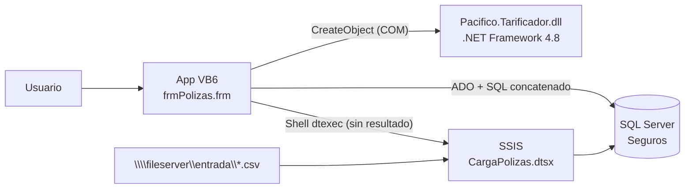
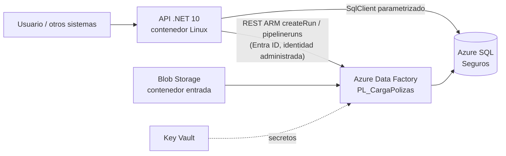
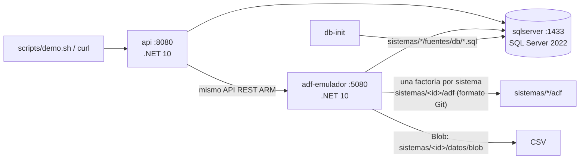

# Arquitectura: legado → objetivo → entorno local

## Sistema legado de ejemplo: pólizas (emulado en `sistemas/polizas/fuentes/`)

## Arquitectura objetivo (Azure)

- **Tarificador**: la lógica del componente COM pasa al proyecto `Pacifico.Polizas.Dominio` (sin COM, sin Windows).
- **ETL**: el paquete SSIS se convierte con `tools/ssis2adf` a un pipeline de ADF (Script → Copy → Stored Procedure, con rama de error y `Fail`).
- **Invocación**: la API llama al API REST de ADF y expone el estado de la carga y de cada actividad (`GET /api/cargas/{runId}`), en vez de lanzar `dtexec` sin ver el resultado.
- **Contenedor**: dónde corre (AKS, Container Apps, App Service) queda pendiente de las especificaciones del cliente. La imagen es estándar (`mcr.microsoft.com/dotnet/aspnet:10.0`, usuario no root, puerto 8080).

## Entorno local de la POC (`docker-compose.yml`)

Para pasar a Azure **no cambia el código de la API**, solo su configuración:

| Variable | Local | Azure |
|---|---|---|
| `DataFactory__BaseUrl` | `http://adf-emulador:8080` | `https://management.azure.com` (por defecto) |
| `DataFactory__UsarAzureAd` | `false` | `true` (por defecto): `DefaultAzureCredential` |
| `DataFactory__SubscriptionId` / `ResourceGroup` / `FactoryName` | valores de prueba | los de la factoría real |
| `ConnectionStrings__Seguros` | SQL Server del compose | Azure SQL (idealmente con identidad administrada) |

La identidad de la API necesita el rol **Data Factory Contributor** (o un rol propio con `pipelines/createRun/action` y lectura de `pipelineruns`) sobre la factoría.

## Qué emula y qué no el emulador de ADF

| Emula | No emula (o simplifica) |
|---|---|
| Rutas y formato del API REST: `createRun`, `pipelineruns/{id}`, `queryActivityruns`, `pipelines`; varias factorías (una por sistema) | Autenticación (acepta cualquier solicitud) |
| Actividades `Script`, `SqlServerStoredProcedure`, `Copy` (DelimitedText o tabla/consulta SQL → AzureSqlTable), `ExecutePipeline`, `Fail`, `Wait` | Mapping Data Flows, ForEach, If, Lookup y demás actividades |
| Condiciones `Succeeded`/`Failed`/`Completed`/`Skipped` y la regla de estado final por actividades hoja (con Skipped se evalúa el padre) | Reintentos, timeouts y concurrencia de la factoría |
| Parámetros de pipeline y de dataset; expresiones `pipeline()`, `dataset()`, `activity()`, `concat`, `if`, `empty`, `utcNow`, `formatDateTime`, `convertFromUtc`… | El resto del lenguaje de expresiones |
| Key Vault (secretos desde variables `KeyVault__<secreto>`) y Blob Storage (carpeta local) | Integration Runtime, red privada, triggers |
| Mensajes de error con el formato de ADF (aproximado) | Códigos de error exactos de cada conector |

La validación final del pipeline se hace publicándolo en una factoría real (los JSON de `sistemas/<id>/adf/` se importan tal cual con la integración Git de ADF).
