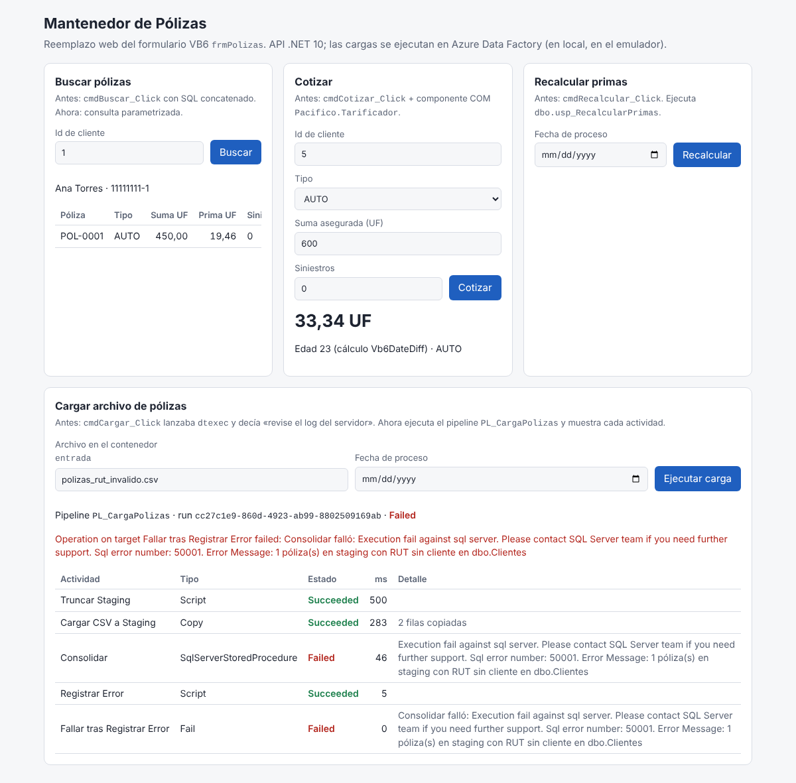

# Cómo verificar que funciona

## Opción 1: un comando

Requisitos e instalación por sistema operativo: [INSTALACION_LOCAL.md](INSTALACION_LOCAL.md). `scripts/verificar.sh` ejecuta primero `scripts/requisitos.sh`.

```bash
git clone <repo> && cd poc-pacifico-seguros
git checkout poc/estructura-ingenieria-inversa
scripts/verificar.sh
```

Ejecuta siete pasos y deja el informe en `portafolio/VERIFICACION.md` (los logs, en `portafolio/logs/`):

| Paso | Qué comprueba |
|---|---|
| 1. Análisis del portafolio | Inventario, REA sobre los binarios y conversión SSIS → ADF de todos los sistemas |
| 2. Transformación VB6 → .NET 10 | `tools/vb62net` genera el proyecto .NET 10 desde el VB6 y **compila** (con advertencias como errores) |
| 3. Validación de ADF | Referencias, dependencias, ciclos, parámetros y expresiones de todos los pipelines |
| 4. Pruebas .NET | 30 de la app (incluida la **paridad contra el binario legado**), 12 del emulador de ADF y 11 del módulo de compatibilidad VB6 |
| 5. Entorno local | `docker compose up`: SQL Server con las BDs legadas, emulador de ADF, app terminada (:8080) y app generada (:8081) |
| 6. Punta a punta | `scripts/demo.sh`: 19 verificaciones contra las APIs y los pipelines en ejecución |
| 7. Cobertura | Cada evento del formulario VB6 tiene su endpoint en la app terminada (OpenAPI) |

Variantes: `--sin-docker` (pasos 1 a 3, sin levantar nada) y `--sin-decompilar` (más rápido). Detrás de un proxy con certificado propio: `CA_BUNDLE=/ruta/ca.crt scripts/verificar.sh`.

## Opción 2: verlo funcionando

Con el entorno levantado (`docker compose up -d --build`):

1. Abra **http://localhost:8080**: la pantalla que reemplaza al formulario VB6 `frmPolizas`.

   

   - **Buscar** cliente 1 → sus pólizas.
   - **Cotizar** cliente 5, AUTO, 600 UF, 0 siniestros → **33,34 UF** (el mismo resultado que el componente legado: redondeo al par, hallazgo P1).
   - **Cargar** `polizas_20261017.csv` → el pipeline de ADF termina en *Succeeded* y se ve cada actividad.
   - **Cargar** `polizas_rut_invalido.csv` → *Failed*: falla la consolidación, se registra el error y la actividad `Fail` deja el pipeline fallido (hallazgo P7).
   - **Cargar** `polizas_formato_invalido.csv` → *Failed* en la copia, con la fila y la columna del error.
2. Compare con la **app generada automáticamente** desde el VB6 (sin retoques):
   `curl "http://localhost:8081/api/polizas/buscar?Cliente=1"` funciona; `POST /api/polizas/cotizar` responde **501 Pendiente de migrar**, porque la lógica del componente COM no se traduce de forma mecánica (por eso existe la app terminada).
3. Revise lo que se transformó:
   - `sistemas/polizas/transformacion/MAPEO_VB6_NET.md`: cada procedimiento VB6, su destino en .NET y su estado.
   - `sistemas/polizas/transformacion/Polizas.Generado/Endpoints.cs`: el código generado, con el VB6 original en comentarios `VB6|`.
   - `sistemas/*/adf/REPORTE_CONVERSION.md` y `pipeline/*.json`: los pipelines generados desde los `.dtsx`.

## Qué se transforma automáticamente y qué no

| Origen | Automático | Requiere trabajo |
|---|---|---|
| VB6: SQL concatenado | Consulta parametrizada | — |
| VB6: ADO con procedimiento almacenado | Llamada parametrizada | — |
| VB6: `Shell dtexec paquete.dtsx` | Ejecución del pipeline en ADF | — |
| VB6: combos cargados en `Form_Load` | Endpoint de catálogos | — |
| VB6: funciones simples de módulos (`Fn = expresión`) | C# con semántica VB6 (`Vb6.DateDiff`, `CInt` al par, configuración regional) | — |
| VB6: lógica con varias sentencias, COM, UI | Esqueleto con el VB6 en comentarios; responde 501 | Migrar a mano o con un agente; validar con pruebas de paridad |
| SSIS: Execute SQL, Execute Package, Data Flow simple, precedencias | Actividades de ADF equivalentes | — |
| SSIS: Script Task, Send Mail, Data Flow complejo, contenedores | Marcador `Wait` con aviso | Reescribir en ADF (Function, Logic App, Mapping Data Flow) |
| .NET antiguo (ASMX, WinForms, Web Forms) | Inventario, ruta sugerida y análisis REA | Migrar con .NET Upgrade Assistant o reescribir (no hay generador en esta versión) |

## Con los sistemas reales del cliente

```bash
python3 tools/portafolio/portafolio.py nuevo <id> --nombre "<Nombre>"
# copiar los fuentes en sistemas/<id>/fuentes/
scripts/verificar.sh --sin-docker     # análisis + transformación + validación de ADF
```

Para los pasos 4 a 7 hace falta además agregar el sistema a `docker-compose.yml` (BD, secretos del emulador) y sus verificaciones a `scripts/demo.sh`; ver [GUIA_MULTISISTEMA.md](GUIA_MULTISISTEMA.md).
