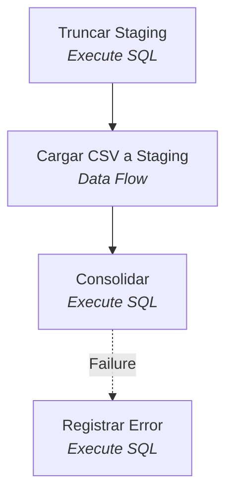

# Inventario de ingeniería inversa

| Elemento | Cantidad |
|---|---|
| Paquetes SSIS | 1 |
| Tareas SSIS | 4 |
| Archivos T-SQL | 4 |
| Objetos de BD definidos | 6 |
| Archivos VB6/.NET | 3 |
| Proyectos VB6/.NET | 1 |
| Tareas SSIS sin conversión directa | 0 (Script Tasks: 0) |
| Paquetes SSIS formato 2005/2008 | 0 |

## Proyectos y ruta de migración

| Proyecto | Tipo | Framework | Esfuerzo | Ruta sugerida |
|---|---|---|---|---|
| `vb6/Polizas.vbp` | VB6 aplicación con formularios (VB6) | VB6 runtime (MSVBVM60) · Código nativo | Alto | Reescribir: UI web o API .NET 10; reglas de negocio a una biblioteca .NET 10 |

**Riesgos de `vb6/Polizas.vbp`**

- Compilado a código nativo: si falta el fuente, del ejecutable solo se obtiene pseudocódigo (REA + Ghidra/IDA)

## Paquetes SSIS

### CargaPolizas  (`ssis/CargaPolizas.dtsx`)

**Conexiones**

- `OLTP` (OLEDB): `Data Source=SRVSQL01;Initial Catalog=Seguros;Provider=SQLNCLI11.1;User ID=etl;Password=****;`
- `ArchivoPolizas` (FLATFILE): `\\fileserver\entrada\polizas.csv`

**Variables**

- `User::FechaProceso` = `(DT_DBDATE)GETDATE()`

**Flujo de control**



**Tareas**

- **Truncar Staging** — Execute SQL
  ```sql
  TRUNCATE TABLE stg.Polizas
  ```
- **Cargar CSV a Staging** — Data Flow
  - Origen CSV `Microsoft.FlatFileSource` 
  - Convertir tipos `Microsoft.DataConvert` 
  - Buscar Cliente `Microsoft.Lookup` → `SELECT IdCliente, Rut FROM dbo.Clientes`
  - Destino Staging `Microsoft.OLEDBDestination` → `[stg].[Polizas]`
- **Consolidar** — Execute SQL
  ```sql
  EXEC dbo.usp_ConsolidarPolizas ?
  ```
- **Registrar Error** — Execute SQL
  ```sql
  INSERT INTO log.ErroresETL (Paquete, Fecha) VALUES ('CargaPolizas', GETDATE())
  ```

## Objetos T-SQL

| Archivo | Define | Lee | Escribe | Ejecuta |
|---|---|---|---|---|
| `db/01_esquema.sql` | TABLE `dbo.Clientes`, TABLE `dbo.Polizas`, TABLE `stg.Polizas`, TABLE `log.ErroresETL` | — | — | — |
| `db/02_usp_RecalcularPrimas.sql` | PROC `dbo.usp_RecalcularPrimas` | — | `dbo.Polizas` | — |
| `db/03_usp_ConsolidarPolizas.sql` | PROC `dbo.usp_ConsolidarPolizas` | `dbo.Clientes`, `stg.Polizas` | `dbo.Polizas` | `dbo.usp_RecalcularPrimas` |
| `db/04_datos.sql` | — | — | `dbo.Clientes`, `dbo.Polizas` | — |

## Aplicación VB6 / .NET

### `vb6/Polizas.vbp` (VB6)

- Conexiones: —
- Procedimientos llamados: —

### `vb6/frmPolizas.frm` (VB6)

- Conexiones: —
- Procedimientos llamados: `dbo.usp_RecalcularPrimas`
- Componentes COM: `PacificoTarificador.Tarificador`
- Procesos externos:
  - `Shell comando, vbHide`
- SQL embebido:
  - `SELECT NumPoliza, TipoSeguro, Prima, Estado FROM dbo.Polizas WHERE IdCliente =`
  - `SELECT FechaNacimiento FROM dbo.Clientes WHERE IdCliente =`
  - `SELECT * FROM dbo.Polizas WHERE Estado =`

### `vb6/modConexion.bas` (VB6)

- Conexiones: `Provider=SQLOLEDB;Data Source=SRVSQL01;Initial Catalog=Seguros;User ID=app;Password=****`
- Procedimientos llamados: —
- Procesos externos:
  - `RUTA_DTEXEC = C:\Program Files\Microsoft SQL Server\150\DTS\Binn\dtexec.exe`
  - `RUTA_PAQUETE = \\SRVSQL01\ETL\CargaPolizas.dtsx`

## Matriz de dependencias (objeto → quién lo usa)

| Objeto | Usado por |
|---|---|
| `COM:PacificoTarificador.Tarificador` | APP:vb6/frmPolizas.frm |
| `dbo.Clientes` | APP:vb6/frmPolizas.frm, SQL:db/04_datos.sql, SQL:dbo.usp_ConsolidarPolizas, SSIS:CargaPolizas/Cargar CSV a Staging |
| `dbo.Polizas` | APP:vb6/frmPolizas.frm, SQL:db/04_datos.sql, SQL:dbo.usp_ConsolidarPolizas, SQL:dbo.usp_RecalcularPrimas |
| `dbo.usp_ConsolidarPolizas` | SSIS:CargaPolizas/Consolidar |
| `dbo.usp_RecalcularPrimas` | APP:vb6/frmPolizas.frm, SQL:dbo.usp_ConsolidarPolizas |
| `log.ErroresETL` | SSIS:CargaPolizas/Registrar Error |
| `stg.Polizas` | SQL:dbo.usp_ConsolidarPolizas, SSIS:CargaPolizas/Cargar CSV a Staging, SSIS:CargaPolizas/Truncar Staging |
