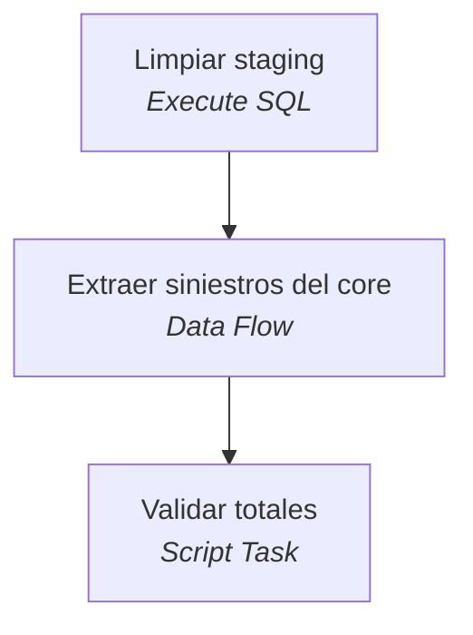
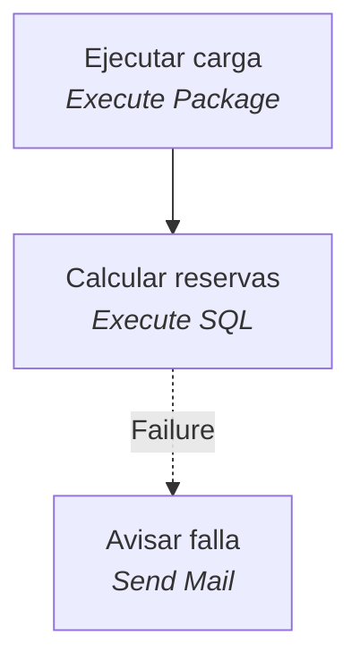

# Inventario de ingeniería inversa

| Elemento | Cantidad |
|---|---|
| Paquetes SSIS | 2 |
| Tareas SSIS | 6 |
| Archivos T-SQL | 3 |
| Objetos de BD definidos | 4 |
| Archivos VB6/.NET | 4 |
| Proyectos VB6/.NET | 2 |
| Tareas SSIS sin conversión directa | 2 (Script Tasks: 1) |
| Paquetes SSIS formato 2005/2008 | 0 |

## Proyectos y ruta de migración

| Proyecto | Tipo | Framework | Esfuerzo | Ruta sugerida |
|---|---|---|---|---|
| `dotnet/Siniestros.Reportes/Siniestros.Reportes.csproj` | WinForms (C#) | v4.0 | Medio | WinForms en .NET 10 (solo Windows, no contenedor Linux) o reescribir como web |
| `dotnet/Siniestros.Web/Siniestros.Web.csproj` | Servicio ASMX (C#) | v3.5 | Alto | API REST en ASP.NET Core; CoreWCF si los consumidores exigen SOAP |

**Riesgos de `dotnet/Siniestros.Reportes/Siniestros.Reportes.csproj`**

- Crystal Reports: no tiene versión para .NET moderno en Linux; evaluar SSRS, Power BI o una librería de PDF

**Riesgos de `dotnet/Siniestros.Web/Siniestros.Web.csproj`**

- LINQ to SQL: no existe en .NET 10; migrar a EF Core o SqlClient
- Servicios ASMX: no existen en .NET 10
- .NET Framework v3.5 (CLR 2): el salto a .NET 10 es mayor; revisar APIs obsoletas

## Paquetes SSIS

### Carga_Siniestros  (`ssis/Carga_Siniestros.dtsx`)

**Conexiones**

- `CORE` (OLEDB): `Data Source=SRVCORE;Initial Catalog=CoreLegado;Provider=SQLNCLI11.1;Integrated Security=SSPI;`
- `DW` (OLEDB): `Data Source=SRVSQL02;Initial Catalog=Siniestros;Provider=SQLNCLI11.1;User ID=etl;Password=****;`

**Flujo de control**



**Tareas**

- **Limpiar staging** — Execute SQL
  ```sql
  TRUNCATE TABLE stg.Siniestros
  ```
- **Extraer siniestros del core** — Data Flow
  - Movimientos vigentes `Microsoft.OLEDBSource` → `SELECT NRO_SINIESTRO AS NumSiniestro, NRO_POLIZA AS NumPoliza, TIPO AS Tipo, FEC_DENUNCIA AS FechaDenuncia, MONTO_UF AS MontoUF FROM dbo.SINIESTRO_MOV WHERE VIGENTE = 1`
  - Convertir montos `Microsoft.DataConvert` 
  - Staging siniestros `Microsoft.OLEDBDestination` → `[stg].[Siniestros]`
- **Validar totales** — Script Task

### Maestro_Siniestros  (`ssis/Maestro_Siniestros.dtsx`)

**Conexiones**

- `DW` (OLEDB): `Data Source=SRVSQL02;Initial Catalog=Siniestros;Provider=SQLNCLI11.1;User ID=etl;Password=****;`

**Variables**

- `User::FechaCorte` = `(DT_DBDATE)GETDATE()`

**Flujo de control**



**Tareas**

- **Ejecutar carga** — Execute Package
- **Calcular reservas** — Execute SQL
  ```sql
  EXEC dbo.usp_CalcularReservas ?
  ```
- **Avisar falla** — Send Mail

## Objetos T-SQL

| Archivo | Define | Lee | Escribe | Ejecuta |
|---|---|---|---|---|
| `db/01_esquema.sql` | TABLE `dbo.SINIESTRO_MOV`, TABLE `stg.Siniestros`, TABLE `dbo.Siniestros` | — | — | — |
| `db/02_usp_CalcularReservas.sql` | PROC `dbo.usp_CalcularReservas` | — | `dbo.Siniestros` | — |
| `db/03_datos.sql` | — | — | `dbo.SINIESTRO_MOV` | — |

## Aplicación VB6 / .NET

### `dotnet/Siniestros.Reportes/FrmReservas.cs` (C#)

- Conexiones: `Data Source=SRVSQL02;Initial Catalog=Siniestros;Integrated Security=SSPI`
- Procedimientos llamados: —

### `dotnet/Siniestros.Web/ServicioSiniestros.asmx` (ASP.NET)

- Conexiones: —
- Procedimientos llamados: —

### `dotnet/Siniestros.Web/ServicioSiniestros.asmx.cs` (C#)

- Conexiones: —
- Procedimientos llamados: `dbo.usp_CalcularReservas`
- SQL embebido:
  - `SELECT NumSiniestro, Tipo, FechaDenuncia, MontoUF, ReservaUF FROM dbo.Siniestros WHERE NumPoliza =`

### `dotnet/Siniestros.Web/Web.config` (.NET config)

- Conexiones: `Data Source=SRVSQL02;Initial Catalog=Siniestros;User ID=websin;Password=****`
- Procedimientos llamados: —

## Matriz de dependencias (objeto → quién lo usa)

| Objeto | Usado por |
|---|---|
| `dbo.SINIESTRO_MOV` | SQL:db/03_datos.sql, SSIS:Carga_Siniestros/Extraer siniestros del core |
| `dbo.Siniestros` | APP:dotnet/Siniestros.Web/ServicioSiniestros.asmx.cs, SQL:dbo.usp_CalcularReservas |
| `dbo.usp_CalcularReservas` | APP:dotnet/Siniestros.Web/ServicioSiniestros.asmx.cs, SSIS:Maestro_Siniestros/Calcular reservas |
| `stg.Siniestros` | SSIS:Carga_Siniestros/Extraer siniestros del core, SSIS:Carga_Siniestros/Limpiar staging |
